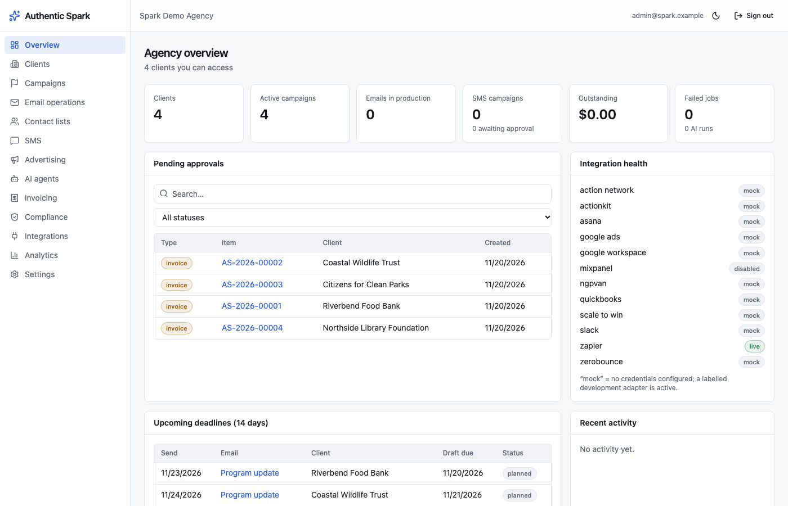
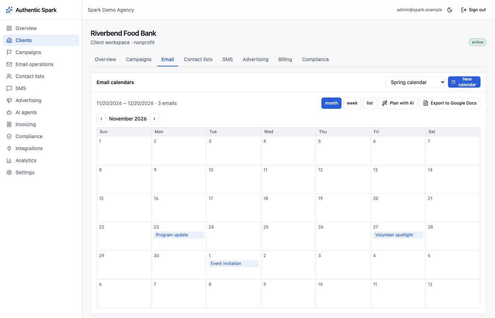

# Authentic Spark

An AI-assisted operations platform for digital agencies, nonprofits, fundraising organizations and campaigns. One
multi-tenant application replaces disconnected tools for client management, email planning and production, vendor
contact lists, SMS administration, ad creative review, invoicing, deliverability/compliance and automation.

> Original project with synthetic data. Not affiliated with any agency, vendor or client.

<p align="center">
  
  
</p>

<p align="center">
  
  
  
  
  
  
</p>

## Highlights

- **Multi-client isolation** — agency → clients → campaigns; every query is tenant-scoped and every route enforces
  RBAC server-side (9 roles, agency/client/module-level grants). Cross-tenant access returns 404.
- **Email operations** — calendar planning (AI proposal → human approval → scheduled emails), Google Doc → email-safe
  HTML conversion, 14 validation checks, sandboxed preview, approval, test-send prep, CRM draft handoff, Asana tasks.
- **List Buys** — CSV upload with column mapping, validation, in-file and cross-list de-duplication, suppression
  matching, ZeroBounce verification as a background job, auditable source/consent, NGP VAN bulk-import handoff.
- **SMS** — consent-only recipient counts, STOP keyword auto-suppression, compliance checks, approval gate,
  provisioning (never sending).
- **Advertising** — Meta/Google creatives with character limits, proofreading, disclosure and brand checks,
  versioning, review/approval; read-only Google Ads reporting.
- **Invoicing** — previews, finance approval, idempotent QuickBooks invoice creation, PDF generation, signed and
  de-duplicated QuickBooks webhooks syncing payments.
- **Compliance** — SPF/DKIM/DMARC DNS checks, global + client suppression lists, AI-assisted unsubscribe
  classification where **explicit opt-outs are always honored by rules first**, human review for ambiguous cases.
- **AI hub** — six agents with input/output JSON schemas, permissions, approval requirements, execution history,
  token usage and audit logs; OpenAI structured outputs with a labelled deterministic fallback.
- **Automation** — signed outbound webhooks (Zapier REST-hook compatible) with retries and idempotency, signed
  inbound webhooks, DB-backed job queue driven by Cloud Scheduler, per-client Slack routing, Mixpanel events.

## Stack

| Layer | Tech |
|---|---|
| Web | Next.js 15, React 19, TypeScript, Tailwind CSS 4, Radix UI, TanStack Query, Zustand |
| API | Python 3.12+, Quart (async), SQLAlchemy 2 async, Pydantic 2, Hypercorn |
| Data | PostgreSQL (Cloud SQL) in production; SQLite for local dev/tests |
| Auth | Firebase Authentication (ID token verification server-side) |
| AI | OpenAI Chat Completions with strict JSON-schema outputs, provider-independent interface |
| Infra | Docker, Cloud Run, Cloud Build, Cloud Scheduler, Secret Manager, Cloud Storage, GitHub Actions |

## Quick start (local, no credentials needed)

```bash
# API
cd backend
python3 -m venv .venv && .venv/bin/pip install -r requirements-dev.txt
cp .env.example .env   # optional; defaults work
.venv/bin/python -m app.seed
.venv/bin/hypercorn app.main:app -b 127.0.0.1:8080

# Web (new terminal)
cd frontend
npm install
cp .env.example .env.local
npm run dev            # http://localhost:3000 — sign in as admin@spark.example
```

`AUTH_MODE=dev` accepts `dev:<email>` bearer tokens for local work only; it is refused when `APP_ENV=production`.
Seeded users: `admin@`, `ops@`, `email@`, `finance@`, `compliance@` (agency-wide) and `am@spark.example`
(account manager scoped to one client — useful for seeing isolation).

With Docker: `docker compose up --build` then `docker compose exec api python -m app.seed`.

## Configuration

Backend (`backend/.env.example`) — every provider is optional; without credentials an explicitly labelled mock
adapter is used and shown as **mock** in the UI.

| Variable | Purpose |
|---|---|
| `APP_ENV` | `development` or `production` (production refuses dev auth, enables HSTS) |
| `DATABASE_URL` | SQLAlchemy async URL (`sqlite+aiosqlite:///...` locally, `postgresql+asyncpg://...` in prod) |
| `AUTH_MODE` / `FIREBASE_PROJECT_ID` | `dev` tokens locally, `firebase` ID-token verification in prod |
| `CORS_ORIGINS`, `OAUTH_REDIRECT_BASE` | Web origin(s) and public API base for OAuth callbacks |
| `WEBHOOK_SIGNING_SECRET`, `SCHEDULER_TOKEN` | Inbound webhook HMAC secret; Cloud Scheduler bearer token |
| `OPENAI_API_KEY`, `OPENAI_MODEL` | AI agents (rule-based fallback when unset) |
| `ZEROBOUNCE_API_KEY` | Email verification |
| `NGPVAN_APP_NAME`, `NGPVAN_API_KEY` | NGP VAN bulk imports |
| `ASANA_ACCESS_TOKEN`, `ASANA_WEBHOOK_SECRET` | Production task handoff + webhooks |
| `SLACK_BOT_TOKEN` | Team notifications |
| `QBO_CLIENT_ID`, `QBO_CLIENT_SECRET`, `QBO_WEBHOOK_VERIFIER_TOKEN`, `QBO_ENVIRONMENT` | QuickBooks Online |
| `GOOGLE_OAUTH_CLIENT_ID`, `GOOGLE_OAUTH_CLIENT_SECRET`, `GOOGLE_ADS_DEVELOPER_TOKEN` | Google Workspace / Ads |
| `MIXPANEL_TOKEN` | Product analytics |

Frontend (`frontend/.env.example`): `NEXT_PUBLIC_API_URL`, `NEXT_PUBLIC_AUTH_MODE`, and the public Firebase web
config (`NEXT_PUBLIC_FIREBASE_*`). Never put secrets in `NEXT_PUBLIC_*` variables. In production, secrets come from
Google Secret Manager.

## Usage

1. Sign in, then open **Clients** and pick a workspace (or create a client).
2. **Email** tab: create a calendar → *Plan with AI* → approve → assign authors → *Export to Google Docs* /
   *Hand off to Asana*. Create a production from an approved doc, review checks and preview, approve, hand off as a draft.
3. **Contact lists**: upload a vendor CSV, map columns, record consent evidence, verify, export, submit to NGP VAN.
4. **SMS / Advertising / Billing**: draft → checks → submit → approve → provision / issue.
5. **Compliance**: add sending domains and run DNS checks, log inbound replies, review flagged opt-outs.
6. **Settings**: invite members with roles and client/module scope, subscribe automation webhooks, run/retry jobs,
   browse the audit log. **AI agents** lets staff run any agent they are permitted to use.

## Project structure

```
Authentic-Spark/
├── backend/                 Quart API (Python)
│   ├── app/
│   │   ├── core/            config, db, Firebase auth, RBAC, errors, logging, audit, rate limiting
│   │   ├── blueprints/      REST modules under /api/v1
│   │   ├── services/        domain logic, AI agents, integration adapters
│   │   ├── jobs/            DB-backed job queue + handlers
│   │   ├── models.py        SQLAlchemy models
│   │   └── seed.py          synthetic demo data
│   └── tests/               pytest suite
├── frontend/                Next.js app (TypeScript)
│   ├── src/app/             routes: overview, clients, module pickers, AI, integrations, analytics, settings
│   ├── src/components/      UI kit, shell, client-workspace modules
│   ├── src/lib/             API client, Firebase auth, permissions, stores
│   ├── tests/  e2e/         Vitest and Playwright
├── infra/                   Cloud Build, Cloud Scheduler, GCP setup notes
├── docs/                    architecture, module and integration docs (Mermaid)
├── docker-compose.yml
└── .github/workflows/ci.yml
```

## Tests

```bash
cd backend && .venv/bin/pytest -q            # 52 API/unit tests
cd frontend && npm test && npm run build     # Vitest + production build
npm run e2e                                  # Playwright (needs API on :8080 and web on :3000)
```

## Contributing

1. Create a feature branch from `main`.
2. Keep routes thin: validation + authorization in the blueprint, logic in `services/`.
3. Every new route must enforce permissions server-side and have tests, including a cross-client isolation case.
4. Integrations must use documented endpoints only; add a labelled mock for local development.
5. Run `ruff`, `mypy`, `pytest`, `npm run lint`, `npm run typecheck`, `npm test` and `npm run build` before opening a PR.
6. Never commit secrets or real personal data — use synthetic `example.org` records.

## Documentation

See [`docs/`](docs) — architecture, database, auth, multi-client design, every module and integration, deployment
and testing — and [`PROJECT_PROGRESS.md`](PROJECT_PROGRESS.md) for status, required credentials and limitations.
API reference: `GET /api/v1/openapi.json`.

## Safety and policy constraints (by design)

- No outbound email or SMS is ever sent by the platform; it prepares, validates, approves and hands off drafts.
- Campaign-facing copy is human-authored and human-approved; AI is limited to administrative assistance.
- No voter profiling, sensitive-trait targeting or political persuasion generation.
- Advertising activation and spend happen only in the ad platforms, by people.
- Compliance features support review; they are not legal advice.
