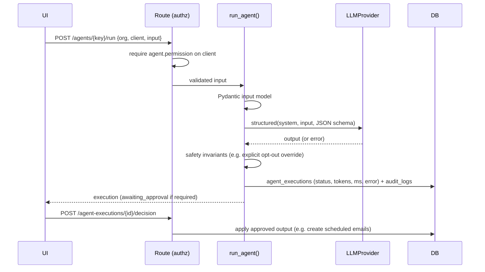

# AI agents

| Agent | Permission | Approval | Purpose |
|---|---|---|---|
| email_calendar_planner | email:write | yes | dates/themes/deadlines from staff inputs (deterministic) |
| proofreader | email:read | no | mechanical issues in human copy |
| unsubscribe_classifier | compliance:write | no | opt-out intent; explicit phrases always win |
| task_extractor | campaigns:read | yes | action items from notes |
| summarizer | ai:read | no | internal summaries |
| data_classifier | ai:read | no | staff-defined categories |

Provider: `OpenAIProvider` (Chat Completions, `response_format=json_schema`, `strict=True`, temperature 0) when
`OPENAI_API_KEY` is set; otherwise `RuleBasedProvider`, recorded as `provider=rule_based`. Failures are recorded
(`status=failed`, HTTP 502) — never silently replaced. Policy prompt forbids persuasion, profiling and fabrication.
