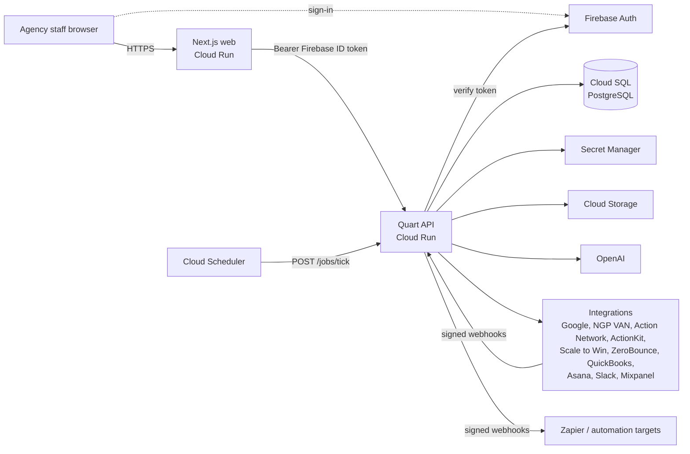
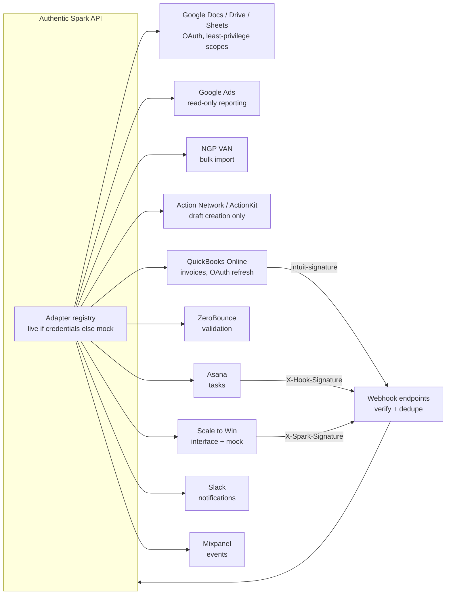

# Architecture



## Backend layout

```
backend/app/
  core/        config, db, auth (Firebase), rbac, errors, logging, audit, rate limit, http helpers
  models.py    SQLAlchemy models (tenant-scoped)
  blueprints/  core, email, contacts, sms, ads, billing, compliance, ai, platform  (all under /api/v1)
  services/    email_production, contacts, dns_checks, suppression, text_checks, events, invoice_pdf
  services/ai  providers (OpenAI / rule-based), agents (registry + orchestrator)
  services/integrations  base HTTP adapter + one module per provider + registry (live vs mock)
  jobs/        DB-backed queue (runner) and handlers
```

Principles:
- **Thin routes, reusable services.** Routes validate (Pydantic), authorize, call services, audit.
- **Server-side authorization on every route**, independent of UI visibility.
- **Adapters behind interfaces**; live clients use only documented endpoints; mocks are explicit (`mode="mock"`).
- **Human approval gates** on outbound communications, ad activation, billing and AI-proposed changes.
- **Idempotency** for jobs, webhook events, outbound creates (`external_mappings`) and payments.

Responses are `{"data": ...}` or `{"error": {"code","message","details"}}`; API version prefix `/api/v1`;
OpenAPI at `/api/v1/openapi.json`. Logs are JSON (Cloud Logging-compatible) with secret/PII key redaction and a
request ID per request.

## Third-party integrations



All live adapters share `HttpAdapter`: 20s timeouts, retry with exponential backoff on 429/5xx, `Retry-After`
support, and errors normalized to `IntegrationError` (HTTP 502) with provider details.
