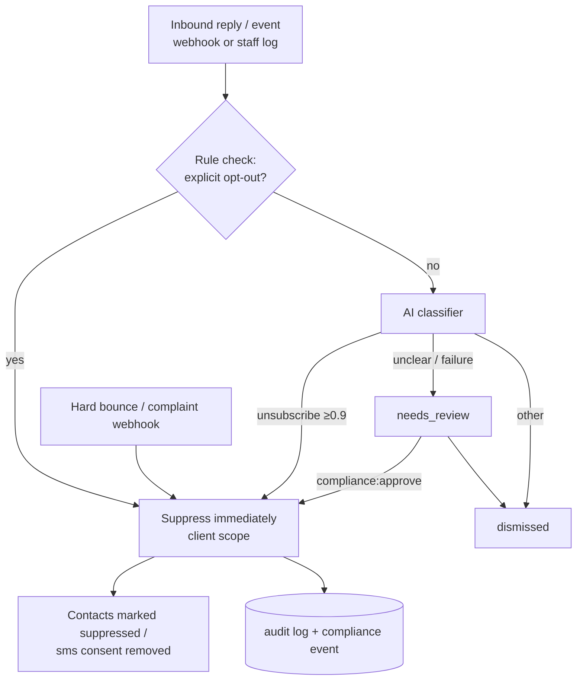

# Compliance & deliverability

- **Explicit opt-outs are never overridden by AI** (enforced in `run_agent` and tested with a provider that lies).
- AI failure never delays a clear opt-out (rules run first) and routes unclear cases to people.
- Suppression lists: client scope and organization-wide global scope (global requires `compliance:approve`);
  enforced at list import, SMS eligibility and on add (existing contacts updated).
- DNS: SPF (single record, permissive `all` warning), DMARC policy (`none` warns), DKIM at configured selectors;
  daily scheduled check opens a compliance event and alert on failure.
- These tools support review and are not legal advice.
