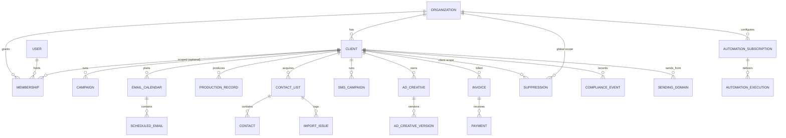

# Database design

**Choice:** PostgreSQL on Cloud SQL in production (relational integrity, transactions for approvals and payments,
JSON columns for flexible validation/check payloads, mature backups/PITR). SQLAlchemy 2 async with `asyncpg`.
SQLite (`aiosqlite`) is used for local development and tests through the same models.

Other tables: `teams`, `projects`, `integration_connections`, `oauth_states`, `external_mappings`, `webhook_events`,
`jobs`, `agent_executions`, `audit_logs`.

Key constraints and indexes:
- Every tenant table has `organization_id` (+ `client_id`), indexed; composite indexes on hot paths
  (`contacts(client_id,email_normalized)`, `scheduled_emails(client_id,send_date)`, `audit_logs(org,client,created_at)`).
- Uniques: `memberships(user,org,client)`, `contacts(list_id,email_normalized)`, `suppressions(org,client,channel,value)`,
  `invoices(org,number)`, `payments(source,external_id)`, `webhook_events(provider,event_key)`,
  `jobs(idempotency_key)`, `external_mappings(provider,idempotency_key)`, `automation_executions(subscription,event)`.
- Timestamps `created_at`/`updated_at` (UTC) on all rows; UUID hex primary keys.

Retention: audit logs 3 years, succeeded jobs 90 days (daily `retention` job). Contact records follow client
agreements. Only synthetic data is used in development and tests.

Migrations: currently `create_all` at startup; adopt Alembic before the first production schema change
(`alembic init`, autogenerate from `Base.metadata`, run `alembic upgrade head` as a Cloud Run job before deploy).
