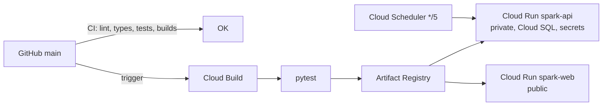

# Deployment



Local: see README (venv + npm, or `docker compose up --build`).

Production (requires authorization; creates billable resources) — follow `infra/setup-gcp.md`, then:
```bash
gcloud builds submit --config infra/cloudbuild.yaml --substitutions=_REGION=us-central1,_API_URL=https://api.example.org,\
_FIREBASE_PROJECT_ID=...,_FIREBASE_API_KEY=...,_FIREBASE_AUTH_DOMAIN=...,_FIREBASE_APP_ID=...,_CLOUDSQL_INSTANCE=proj:region:inst
PROJECT_ID=... REGION=us-central1 API_URL=https://api.example.org SCHEDULER_TOKEN=... infra/scheduler.sh
```

Runtime: health `/healthz`, readiness `/readyz` (DB ping); graceful shutdown on SIGTERM (Hypercorn
`--graceful-timeout`, engine disposal); JSON logs to Cloud Logging with request IDs; unhandled errors logged with
stack traces and returned as `internal_error` with the request ID (pair with Error Reporting). Config is entirely
environment-based; secrets come from Secret Manager via `--set-secrets`.

Note: `spark-api` is deployed `--no-allow-unauthenticated`; front it with an HTTPS load balancer/IAP or allow
unauthenticated ingress only if Firebase auth on every route is your perimeter (it is enforced either way).
