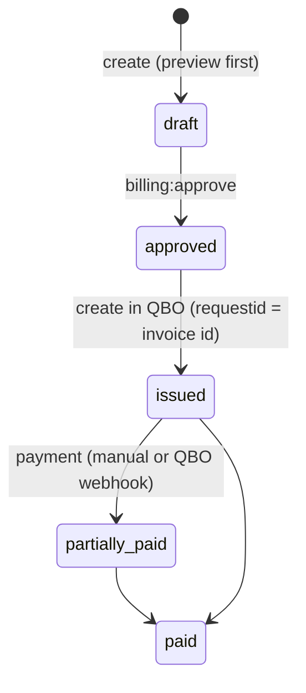

# Invoicing (QuickBooks Online)

- Line items, tax rate, payment terms (due date computed), memo; numbering `AS-<year>-<seq>` unique per org.
- PDF via fpdf2 (`GET /invoices/{id}/pdf`).
- QBO: OAuth authorization URL, refresh-token rotation, invoice create with `requestid` for idempotency, invoice read.
- Webhook `POST /webhooks/quickbooks`: verifies `intuit-signature` (base64 HMAC-SHA256 with verifier token), stores
  each entity event in `webhook_events` (unique key → duplicates ignored), re-reads the invoice and records the paid
  delta as a `payments` row unique on `(source, external_id)`.
- Issuing does not email the invoice; delivery is a human action. No real invoices are created without credentials
  (mock mode) — use the QBO sandbox first.
