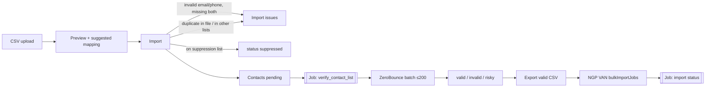

# Contact-list management (List Buys)

- Required provenance: list name, **source vendor**, **usage permission** (`opt_in`, `vendor_attested_opt_in`,
  `transactional`) and **consent evidence** (except transactional). Transactional lists cannot go to CRM import.
- File checks: `.csv` only, ≤20MB, ≤200k rows, binary sniffing, UTF‑8/Latin‑1.
- Phone normalization to E.164 (US); SMS consent column is mapped explicitly.
- Verification never implies permission to send marketing.
- ZeroBounce usage: credits endpoint (integration test), API-call counts recorded on the list stats.
