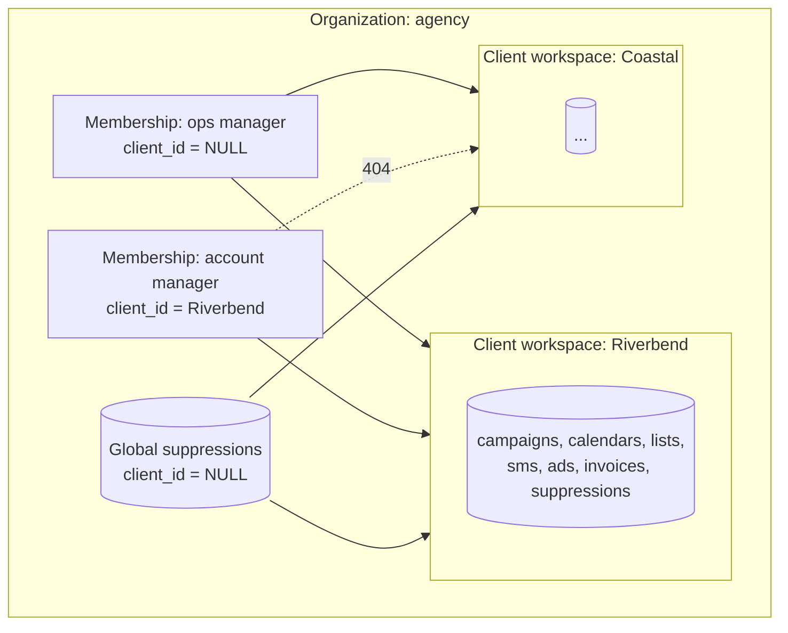

# Multi-client architecture

- Every row carries `organization_id`/`client_id`; list endpoints compute the set of client IDs the caller may access
  for the needed permission (`client_ids_for`) and filter in SQL.
- Detail endpoints load the record and authorize on its own `client_id` (`load_scoped`).
- Client-specific settings (`clients.settings`): Asana project, QuickBooks customer, Google Ads customer, brand terms,
  banned terms, Slack channel routing. Client-specific integrations: `integration_connections.client_id`.
- Workspace UI hides modules the user cannot read; the API enforces the same rules independently.
- Cross-client references are rejected (e.g. an SMS campaign cannot use another client's contact list).
