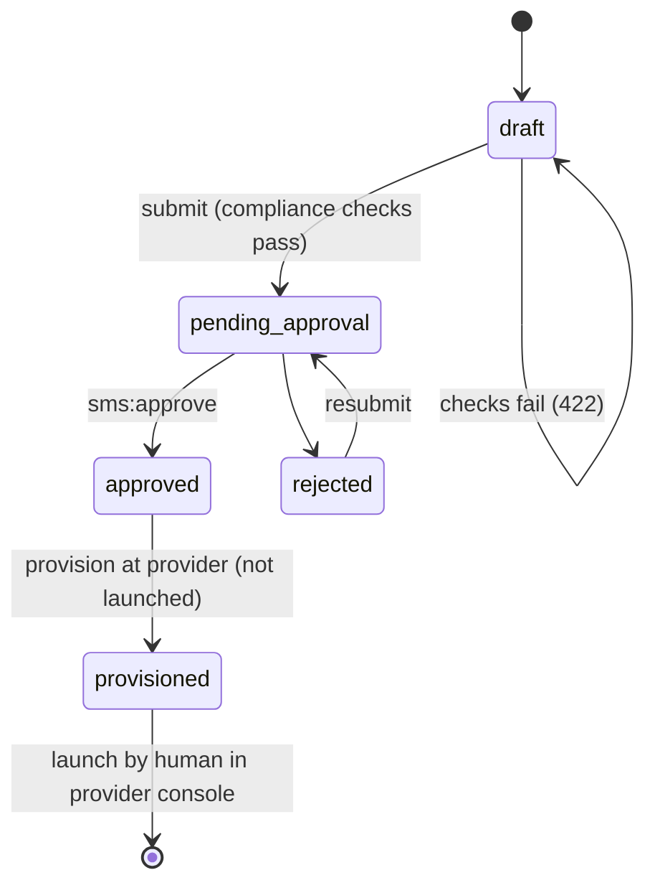

# SMS operations

Compliance checks: opt-out instructions ("Reply STOP"), sender identification, length ≤ 640, human author,
contact list associated, eligible recipients > 0, daily sending limit.

Eligible recipients = contacts in the list with `sms_consent = true`, a valid phone, and not on the client or global
SMS suppression list — recomputed at submit and at provisioning.

**STOP handling**: `POST /webhooks/sms/inbound/{org}/{client}` (HMAC-signed) — STOP/STOPALL/UNSUBSCRIBE/CANCEL/END/QUIT
suppress immediately with no human or AI gate, and are recorded as compliance events.
